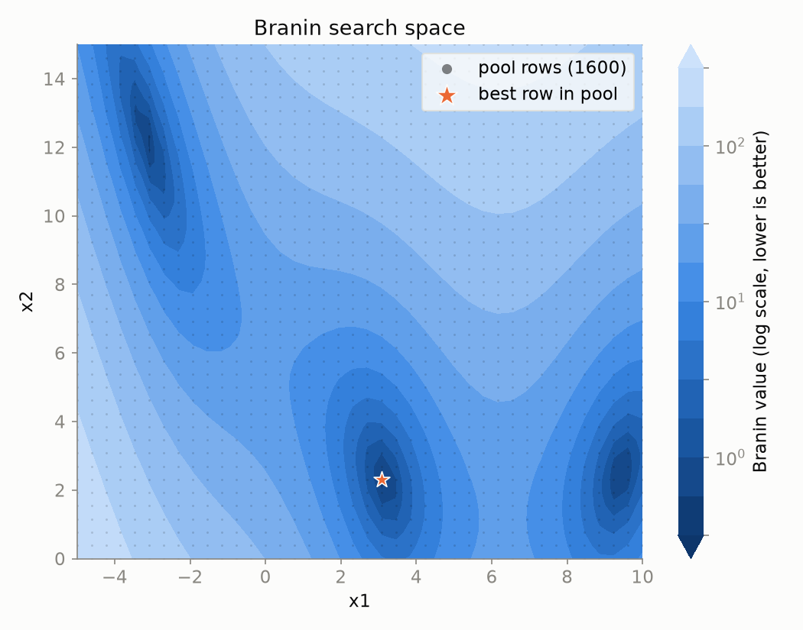
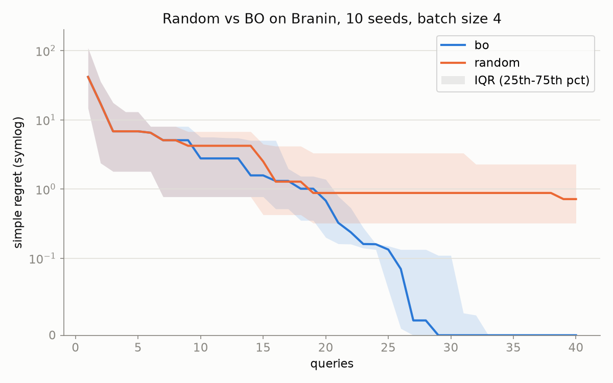

# pool-optimisation-harness

A harness to couple pool optimisers (such as Bayesian optimisation) to datasets in order to aid benchmarking.

Optimisers can only query candidates present in the dataset passed (thus look-up pool optimisation). Supports batch queries and multi-objective search spaces.

This harness was developed as a tool to allow optimisers to be benchmarked on publicly available datasets before being used for an experimental run. It was originally built for electrolyte optimisation (as part of a previous internship) but has been generalised here to work with any tabular dataset.

## Install

Installs as `poolbench`.

```bash
git clone https://github.com/sn1k3sh/pool-optimisation-harness.git
cd pool-optimisation-harness
pip install -e .
```

## Quickstart

```python
import pandas as pd
from poolbench import Pool, RandomOptimizer, BOOptimizer, run, summarize, plot_convergence

df = pd.read_csv("my_data.csv")
pool = Pool.from_dataframe(df, feature_cols=["x1", "x2", "x3"], target_cols="yield")
# multi-objective: target_cols=["capacity", "efficiency"]

results = run(pool, [RandomOptimizer(), BOOptimizer()], budget=50, batch_size=4, n_init=5, seeds=10)
print(summarize(results))
plot_convergence(results, true_value=pool.true_best)
results.to_csv("results.csv", index=False)
```

`run` returns one row per (optimiser, seed, step), with the queried index, the observed objective values, `best_so_far`, `simple_regret` and `queries_to_best`.

### Data requirements

- Feature columns must be numeric, so one-hot encode categoricals first.
- All objectives are maximised, for minimisation objective column needs to be negated.
- Rows with NaNs in any feature or objective column are dropped.

## Example on synthetic data

Using the Branin function (evaluated on a 40 x 40 grid) as an example:



Batch BO can be compared to batch random search (4 candidates sampled at a time each) starting from the same initial points (Sobol-sampled). Over 10 seeds, BO's median regret reaches zero after ~30 queries, while random search is still ~1 away after 40.



## Writing an optimiser

To write a bespoke optimiser, subclass `Optimizer` and implement `ask`:

```python
from poolbench import Optimizer

class MyOptimiser(Optimizer):
    name = "mine"

    def ask(self, state, batch_size):
        # available: state.pool, state.queried_idx, state.observed_y, state.unobserved_idx, state.rng
        ...
        return [...]  # batch_size distinct indices from state.unobserved_idx
```

The harness rejects any batch that is the wrong size, contains duplicates, or includes already-queried rows. Optimisers never see objective values for rows they haven't queried.

An example of a bespoke optimiser is in [`examples/llm_optimizer.py`](examples/llm_optimizer.py), which asks a local Ollama model to choose candidates. For slow optimisers like this, `run(..., n_workers=4)` runs seeds in parallel threads.

## License

MIT